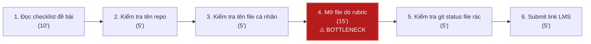
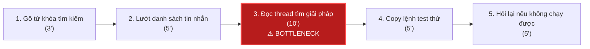
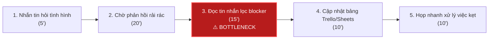

# Báo cáo cá nhân — 2A202603848_ChuVanNhat

> Template chi tiết và prompt mẫu cho từng mục: [docs/01-worksheet.md](../../docs/01-worksheet.md).
> Mỗi thành viên một file trong `report/individual/` trên repo nhóm: copy template này thành file mới, điền, rồi commit bằng tài khoản GitHub của bạn. Không viết hộ người khác.

## 1. Thông tin học viên

- Họ tên: Chu Văn Nhật
- MSSV: 2A202603848
- Email trường: (để trống hoặc ghi nhận nếu cần)
- Tên nhóm: E99
- Link repo nhóm: https://github.com/phamtuan2xx3-alt/K5-L3B-DAY02-E99-DiscoveryProblemFraming

---

## 2. Scan problem (CP1)

Lăng kính: **Lặp lại** · **Tốn thời gian** · **Cần đọc, tổng hợp nhiều thông tin** · **Pain từ người khác**.

| # | Lăng kính | Job Story: Khi… tôi muốn… để… | Ai chịu ảnh hưởng? | Dấu hiệu thật (thời gian, tần suất, số người, bằng chứng) |
|---:|---|---|---|---|
| 1 | Lặp lại | Khi chuẩn bị nộp bài lab môn AI trước hạn chót, tôi muốn đối chiếu nhanh toàn bộ cấu trúc repo và checklist yêu cầu, để không bị trừ điểm oan do sai sót hình thức (sai tên file, thiếu mục). | Sinh viên làm lab, bạn cùng nhóm | Diễn ra 1 lần/tuần trước 23h50; mất trung bình 35–45 phút mở từng file dò thủ công; tuần trước nhóm từng bị trừ 5 điểm vì sót 1 trường trong file report. |
| 2 | Lặp lại | Khi bắt đầu bài lab mới hoặc kéo code của thành viên khác về máy, tôi muốn thiết lập môi trường chạy code tương thích ngay, để không mất thời gian xử lý xung đột phiên bản thư viện. | Cá nhân sinh viên, cả nhóm | 1–2 lần/tuần mỗi khi có lab mới; mất 40–60 phút giải quyết lỗi xung đột thư viện (`torch`, `cuda`, `numpy`); ghi nhận trong lịch sử terminal và tin nhắn hỏi lỗi trên nhóm Discord lớp. |
| 3 | Tốn thời gian | Khi được giao tài liệu hướng dẫn hoặc paper tham khảo dài 15–20 trang tiếng Anh trước buổi lab, tôi muốn nắm bắt được ngay luồng phương pháp và các tham số cốt lõi, để có thể triển khai bài thực hành kịp giờ trên lớp. | Sinh viên thực hành, nhóm nghiên cứu | 2–3 bài lab/tháng; mất 90–120 phút đọc và tra cứu thuật ngữ; nhiều lần đọc xong vẫn phải hỏi lại trợ giảng vì bỏ sót điều kiện tiên quyết. |
| 4 | Tốn thời gian | Khi chạy thử nghiệm mô hình hoặc pipeline xử lý dữ liệu bị crash với stack trace dài hàng trăm dòng, tôi muốn xác định ngay đoạn code thực sự gây ra lỗi, để sửa lỗi nhanh chóng thay vì đọc từng dòng log. | Sinh viên code lab, lập trình viên | 3–4 lần/tuần; mỗi lần mất 25–40 phút tra cứu chuỗi traceback; có log terminal lưu lại hơn 300 dòng lỗi thư viện lồng nhau. |
| 5 | Cần đọc, tổng hợp nhiều thông tin | Khi gặp sự cố kỹ thuật hoặc thắc mắc về đề bài lab, tôi muốn tìm lại nhanh giải đáp mà giảng viên/trợ giảng đã từng trả lời trước đó trong kênh chat lớp, để tự sửa ngay mà không phải hỏi lặp lại. | Sinh viên trong lớp (khoảng 40–50 bạn), trợ giảng | 2–3 lần/tuần; mất 15–20 phút search từ khóa nhưng trôi tin nhắn trong hàng nghìn tin nhắn chat; trợ giảng phải trả lời cùng một câu hỏi cài đặt môi trường ít nhất 4 lần/tuần. |
| 6 | Cần đọc, tổng hợp nhiều thông tin | Khi chuẩn bị cho buổi bảo vệ đồ án hoặc kỳ thi giữa kỳ, tôi muốn tập hợp toàn bộ kiến thức trọng tâm từ các slide, notebook và video bài giảng vào một dàn ý thống nhất, để ôn tập có hệ thống. | Sinh viên, nhóm học tập (3–4 người) | 1 lần trước mỗi đợt thi lớn; mất trọn 1 buổi chiều (khoảng 3–4 tiếng) tải tài liệu từ 4 nền tảng khác nhau (LMS, Colab, Drive, Slides) về đối chiếu. |
| 7 | Pain từ người khác | Khi sắp đến hạn nộp đồ án nhóm, tôi muốn biết chính xác ai đã làm xong phần nào và ai đang gặp vướng mắc (blocker), để chủ động hỗ trợ hoặc phân bổ lại công việc kịp deadline. | Trưởng nhóm, 3–4 thành viên | 2 lần/tuần; nhóm trưởng mất 45–60 phút nhắn tin hỏi từng người và đọc lại thread chat; tuần trước có 1 task bị chậm 2 ngày do thành viên kẹt bug nhưng không thông báo sớm. |
| 8 | Pain từ người khác | Khi kết thúc buổi họp nhóm kéo dài trên Google Meet, tôi muốn có danh sách các việc cần làm kèm người phụ trách và hạn chót rõ ràng, để các thành viên bắt tay vào làm ngay mà không bị quên ý kiến đã thống nhất. | Thành viên ghi chép, cả nhóm 4 người | 1–2 lần/tuần; mất 30 phút nghe lại/viết lại ghi chú sau buổi họp; 2 lần thành viên làm sai yêu cầu vì không có biên bản thống nhất bằng văn bản. |
| 9 | Lặp lại | Khi nhóm phát sinh các chi phí chung (mua tài khoản cloud, in tài liệu, ăn uống làm đồ án), tôi muốn ghi nhận và tính toán số tiền mỗi người phải đóng ngay, để thanh toán sòng phẳng mà không phải tính tay cuối tháng. | Thủ quỹ nhóm, các thành viên | 3–4 lần/tháng; mất 30 phút kiểm tra lịch sử chuyển khoản và nhập Excel; thỉnh thoảng sót hóa đơn dẫn đến chênh lệch tiền quỹ. |
| 10 | Tốn thời gian | Khi đến buổi báo cáo tiến độ với giảng viên hướng dẫn, tôi muốn tổng hợp các commit git và kết quả thử nghiệm trong tuần thành một bản tóm tắt súc tích, để thầy nắm được tiến độ dự án trong 5 phút. | Nhóm sinh viên, giảng viên hướng dẫn | 1 lần/tuần vào chiều Chủ nhật; mất 60–75 phút lục lại commit log và bảng kết quả ghi trên Notion; tuần trước giảng viên nhận xét báo cáo lan man, không làm nổi bật được kết quả đạt được. |

**Nếu có dùng AI để gợi ý thêm:** ý nào AI gợi ý mà bạn giữ lại, ý nào bỏ và vì sao.

- *Ý giữ lại:* Sau khi tự scan 8 vấn đề thực tế của bản thân, tôi tham khảo AI và bổ sung thêm ý #9 (tính toán chi phí nhóm) và ý #10 (tổng hợp báo cáo tiến độ tuần từ commit git). Cả 2 ý này đều xuất hiện thật trong quá trình làm việc nhóm môn học của tôi.
- *Ý bỏ qua:* AI có gợi ý thêm các ý như "Tạo trợ lý AI quản lý toàn diện dự án học tập" và "Tự động sinh toàn bộ code bài tập lớn". Tôi đã loại bỏ ngay vì đây là giải pháp trá hình, phạm vi quá mơ hồ và vi phạm nguyên tắc liêm chính học thuật, không có quy trình thực tế cụ thể.

---

## 3. Top 3 Problem Cards + quy trình nháp (CP2)

### Bảng chọn top 3

| Rank | Problem | Vì sao chọn | Điều còn chưa chắc |
|---:|---|---|---|
| 1 | Kiểm tra checklist và cấu trúc bài nộp lab (#1) | Quy trình rõ ràng, diễn ra đều đặn hàng tuần, bottleneck cụ thể, impact đo được trực tiếp bằng điểm số lab (tránh bị trừ điểm), vừa sức giải quyết. | Chưa chắc liệu giải pháp Rule (script kiểm tra file) đã đủ chưa hay cần Workflow phân tích ngữ nghĩa nội dung các trường markdown. |
| 2 | Tìm lại câu trả lời và hướng dẫn fix lỗi cũ trong kênh chat lớp (#5) | Nhiều bạn trong lớp cùng gặp phải, lặp đi lặp lại hàng tuần, trợ giảng than phiền nhiều về việc trả lời trùng lặp. | Dữ liệu chat trên Discord/Teams có thể khó xuất ra tự động nếu không có quyền quản trị viên bot. |
| 3 | Theo dõi tiến độ task và phát hiện blocker trong làm việc nhóm (#7) | Nỗi đau thực tế của mọi nhóm sinh viên khi làm đồ án, ảnh hưởng trực tiếp đến deadline chung. | Phụ thuộc nhiều vào ý thức tự giác cập nhật thông tin của các thành viên trong nhóm. |

---

### Problem Card #1 — Kiểm tra checklist bài nộp lab

| Trường | Nội dung |
|---|---|
| Job Story | Khi chuẩn bị nộp bài lab môn AI trước hạn chót, tôi muốn đối chiếu nhanh toàn bộ cấu trúc repo và checklist yêu cầu, để không bị trừ điểm oan do sai sót hình thức (sai tên file, thiếu mục). |
| Actor | Sinh viên thực hành các môn công nghệ/AI có nộp bài qua GitHub & LMS |
| Thời điểm / bối cảnh | 22h00 – 23h30 tối ngày deadline nộp bài lab |
| Quy trình hiện tại (3–7 bước) | 1. Đọc lại README và SUBMISSION.md để lấy checklist yêu cầu (10') 2. Kiểm tra tên repo trên GitHub xem đúng cú pháp lớp/nhóm chưa (5') 3. Mở thư mục local kiểm tra tên file cá nhân MSSV_HoTen.md (5') 4. Mở từng file markdown đọc lướt đối chiếu xem đã điền đủ các mục và tiêu chí rubric chưa (15') 5. Kiểm tra git status xem có commit thừa file rác (.env, cache, log) không (5') 6. Copy link repo nộp lên LMS (5') |
| Bottleneck (bước nào, mất bao nhiêu phút) | Bước 4: Mở từng file markdown đọc lướt và đối chiếu từng trường với rubric/template (mất khoảng 15–20 phút, dễ căng thẳng hoa mắt dẫn đến bỏ sót). |
| Impact (nếu không giải thì sao) | Mất trung bình 45 phút/lần nộp. Nếu sai tên file cá nhân hoặc sai tên repo bị trừ ngay 5 điểm; thiếu file team bị 0 điểm phần nhóm; nộp muộn do rà soát chậm bị 0 điểm cả bài. |
| Success metric (baseline → target) | Tổng thời gian rà soát trước khi nộp giảm từ **45 phút** (baseline đo thực tế tuần trước) xuống **dưới 10 phút** (target). Số lỗi sai sót hình thức bị trừ điểm là **0 lỗi**. |
| Phương án không dùng AI | Viết một shell script / checklist cố định để tick tay từng mục; tạo template chuẩn hóa sẵn khung. Giảm được thời gian check tên file, nhưng chưa tự động kiểm tra được độ đầy đủ của nội dung bên trong các trường markdown. |
| Giả thuyết về AI (nếu có) | Kết hợp script kiểm tra cấu trúc (Rule) và mô hình ngôn ngữ (Workflow) để đọc nhanh các file markdown, đánh dấu các trường còn để trống hoặc câu trả lời chưa đạt độ dài tối thiểu theo yêu cầu rubric. |
| Cảm nhận nhanh | Rule hoặc Workflow |

Quy trình nháp hiện tại:

---

### Problem Card #2 — Tìm lại giải đáp fix lỗi cũ trong kênh thảo luận

| Trường | Nội dung |
|---|---|
| Job Story | Khi gặp sự cố kỹ thuật hoặc thắc mắc về đề bài lab, tôi muốn tìm lại nhanh giải đáp mà giảng viên/trợ giảng đã từng trả lời trước đó trong kênh chat lớp, để tự sửa ngay mà không phải hỏi lặp lại. |
| Actor | Sinh viên đang thực hành lab trên lớp hoặc làm bài tại nhà |
| Thời điểm / bối cảnh | Trong giờ thực hành lab hoặc các buổi tối trước hạn nộp |
| Quy trình hiện tại (3–7 bước) | 1. Gõ từ khóa lỗi vào thanh tìm kiếm của Discord/Teams (3') 2. Lướt qua 20–30 tin nhắn kết quả tìm kiếm (5') 3. Mở từng thread chat đọc xem có đúng ngữ cảnh và lỗi của mình không (10') 4. Sao chép câu lệnh/hướng dẫn của trợ giảng ra terminal chạy thử (5') 5. Nếu không chạy được, quay lại tìm thread khác hoặc nhắn tin hỏi lại (5') |
| Bottleneck (bước nào, mất bao nhiêu phút) | Bước 3: Mở từng thread chat đọc nội dung để tìm đúng câu trả lời hữu ích (mất khoảng 10 phút vì tin nhắn rời rạc và nhiễu). |
| Impact (nếu không giải thì sao) | Mất 25–30 phút cho mỗi lần fix lỗi, làm gián đoạn mạch làm bài; trợ giảng bị quá tải vì phải trả lời lặp lại cùng một câu hỏi 4–5 lần/tuần. |
| Success metric (baseline → target) | Thời gian tìm được câu trả lời chính xác giảm từ **28 phút** xuống **dưới 5 phút**; giảm **50%** số lượng câu hỏi trùng lặp gửi đến trợ giảng. |
| Phương án không dùng AI | Trợ giảng tổng hợp danh sách câu hỏi thường gặp (FAQ) thành 1 file Google Docs hoặc GitHub Wiki ghim ở đầu kênh. Tuy nhiên cần người cập nhật thủ công thường xuyên. |
| Giả thuyết về AI (nếu có) | Xây dựng semantic search bot tra cứu câu hỏi dựa trên ý nghĩa ngữ cảnh thay vì chỉ tìm theo từ khóa chính xác. |
| Cảm nhận nhanh | Workflow |

Quy trình nháp hiện tại:

---

### Problem Card #3 — Theo dõi tiến độ task và phát hiện blocker đồ án nhóm

| Trường | Nội dung |
|---|---|
| Job Story | Khi sắp đến hạn nộp đồ án nhóm, tôi muốn biết chính xác ai đã làm xong phần nào và ai đang gặp vướng mắc (blocker), để chủ động hỗ trợ hoặc phân bổ lại công việc kịp deadline. |
| Actor | Trưởng nhóm hoặc thành viên điều phối đồ án môn học |
| Thời điểm / bối cảnh | 2–3 ngày trước milestone báo cáo tiến độ hàng tuần |
| Quy trình hiện tại (3–7 bước) | 1. Nhắn tin vào nhóm chat hỏi thăm tình hình công việc của từng người (5') 2. Chờ các bạn phản hồi rải rác trong ngày (tổng thời gian gom tin: 20') 3. Đọc các tin nhắn giải thích, lọc ra task nào đã xong, task nào đang kẹt (15') 4. Mở Trello / Google Sheets cập nhật lại trạng thái công việc (10') 5. Nhắn tin riêng hoặc họp nhanh để xử lý task bị kẹt (10') |
| Bottleneck (bước nào, mất bao nhiêu phút) | Bước 3: Đọc và tổng hợp các tin nhắn chat rời rạc để xác định chính xác nguyên nhân gây tắc nghẽn (blocker) (mất 15 phút). |
| Impact (nếu không giải thì sao) | Nhóm trưởng mất khoảng 60 phút/lần tổng hợp; nguy cơ vỡ tiến độ đồ án vì phát hiện blocker quá muộn sát deadline. |
| Success metric (baseline → target) | Thời gian tổng hợp tiến độ nhóm giảm từ **60 phút** xuống **dưới 15 phút**; phát hiện các blocker kỹ thuật sớm trước ít nhất **24 giờ**. |
| Phương án không dùng AI | Yêu cầu các thành viên cập nhật trực tiếp lên bảng Kanban (Trello/Notion) mỗi tối; tạo template tin nhắn báo cáo ngắn gọn dạng bullet. |
| Giả thuyết về AI (nếu có) | AI tự động quét tin nhắn trong kênh thảo luận nhóm, trích xuất danh sách công việc đã hoàn thành và cảnh báo blocker cho trưởng nhóm. |
| Cảm nhận nhanh | No AI hoặc Workflow |

Quy trình nháp hiện tại:

---

### Card muốn pitch nhất

- Card số: **Card #1 (Kiểm tra checklist bài nộp lab)**
- Vì sao: Vấn đề cực kỳ thực tế, sát sườn với mọi sinh viên ngay trong buổi học hôm nay; quy trình các bước rất rõ ràng; bottleneck cụ thể; impact đo lường được bằng điểm số cụ thể (tránh bị trừ điểm oan từ 5–10 điểm); ranh giới giữa No AI, Rule và Workflow rất rõ ràng để cả nhóm tranh luận, phản biện.
- Câu hỏi muốn nhóm phản biện: *"Liệu một shell script kiểm tra tên file và thư mục (Rule) đã giải quyết được trọn vẹn bài toán chưa, hay thực sự cần một Workflow có AI để kiểm tra ngữ nghĩa nội dung các mục trong file báo cáo markdown?"*

---

### AI đã phản biện card thế nào

| Điểm yếu AI chỉ ra | Đồng ý? | Đã sửa gì |
|---|---|---|
| Baseline 45 phút cho việc nộp bài có vẻ hơi cao so với thực tế chỉ submit link. | Đồng ý một phần | Đã làm rõ quy trình: 45 phút không phải chỉ bấm nút submit, mà bao gồm toàn bộ quá trình đối chiếu từng file với checklist và đọc lướt rubric để tránh bị trừ điểm. Đã tách rõ từng bước với số phút tương ứng. |
| Tại sao không dùng script kiểm tra (Rule-based) mà phải nghĩ đến AI? Dùng AI có bị "dao mổ trâu giết gà" không? | Hoàn toàn đồng ý | Đã chỉnh mức can thiệp thành "Rule hoặc Workflow" thay vì Agent; nêu rõ phương án No AI/Rule (script check file) và chỉ định vị trí AI có thể hỗ trợ (kiểm tra nội dung các trường markdown có bị để trống hoặc trả lời hời hợt hay không). |
| Success metric ban đầu ghi "đạt 100% không mắc lỗi" quá mơ hồ và khó kiểm chứng. | Đồng ý | Đã sửa thành metric đo lường cụ thể: Thời gian rà soát giảm từ 45' xuống dưới 10' và số lỗi sai sót hình thức bị trừ điểm trên LMS bằng 0. |

---

## 4. Tôi đã tham gia phần nào (CP3 → CP7)

| Hoạt động | Tôi đã làm gì? | Kết quả / ảnh hưởng tới bài nhóm |
|---|---|---|
| Pitch Problem Card | Pitch Card #1 (Kiểm tra checklist bài nộp lab), Card #2 (Tìm giải đáp trên Discord) và Card #3 (Theo dõi blocker nhóm) | Cả 3 card được đưa vào bảng Pitch nhóm (mục 2.1) |
| Phản biện bài của bạn khác | Câu hỏi tôi đã đặt: Hỏi Lâm về Candidate #4: "Các thỏa thuận ngầm hoặc tiếng lóng trong chat Zalo có làm công cụ hiểu sai không?" và Candidate #6: "Dùng tính năng Styles trong Word/LaTeX có đủ giải quyết bài này mà không cần AI không?" | Nhóm nhận thấy bài #6 có thể giải quyết bằng No AI/Rule, còn bài #4 cần xử lý ngôn ngữ tự nhiên phức tạp |
| Nhận phản biện | Câu hỏi tôi nhận được: Lâm hỏi ở Card #1: "Nếu chỉ cần kiểm tra tên file/folder thì một shell script (Rule) có đủ chưa, tại sao cần AI?" | Tôi đã sửa gì: Làm rõ ranh giới Rule (kiểm tra tồn tại và tên file) và Workflow có AI (đọc hiểu ngữ nghĩa nội dung markdown xem có bị để trống hay trả lời cụt lủn không) |
| Gom cluster / cây OST | Đề xuất gom Candidate #6 và Candidate #7 vào chung Cluster D (Kiểm tra đầu ra); góp ý xác định Outcome duy nhất là giảm 30% thời gian rà bài lab mà không tăng lỗi bỏ sót | Nhóm thống nhất cấu trúc 4 cluster và xây dựng cây OST với Outcome có metric rõ ràng thay vì mục tiêu mơ hồ |
| Chọn candidate problem | Trình bày lý do bảo vệ Candidate #7 (Đối chiếu checklist lab): dữ liệu đầu vào sẵn có trong chính buổi học, quy trình rõ, dễ đo lường và vừa sức làm trong một buổi lab | Nhóm thống nhất chấm Candidate #7 đạt điểm cao nhất (33/35) và chọn làm bài toán chung của nhóm |
| Kiểm chứng / research | Cung cấp trải nghiệm thực tế về việc từng bị trừ 5 điểm do thiếu trường report để Tuấn đưa vào Assumption Map (#1, #2); hỗ trợ review bảng so sánh 3 công cụ lint | Xác định được pain thật sự nằm ở công đoạn định vị và đối chiếu mục, không phải ở việc sửa bài |
| Quy trình nhóm | Phụ trách chính: Trực tiếp vẽ 2 sơ đồ Mermaid (Quy trình hiện tại và Quy trình tương lai với Rule), phân rã chi tiết 6 bước kèm số phút và xác định bottleneck bước 4 (15 phút) | Nhóm có sơ đồ trực quan rõ ràng, làm rõ vai trò Con người / Rule và thiết lập phương án fallback khi công cụ gặp sự cố |
| Problem Statement | Soạn thảo bản dự thảo Problem Statement v0 gồm 6 trường; tiếp thu phản biện của AI để tách riêng 5 phút nộp LMS ra khỏi thời gian rà bài | Nhóm có bản Problem Statement v0 chuẩn chỉnh, định nghĩa Success Metric đo lường được (giảm từ 40' xuống ≤28') |
| Mức can thiệp AI | Thảo luận cùng nhóm về ma trận phức tạp/mơ hồ; ủng hộ phương án chọn mức Rule và giữ No AI làm đối chứng/fallback thay vì vội vã dùng LLM/Agent | Tránh được bẫy lạm dụng AI khi quy tắc kiểm tra hình thức có luồng cố định; tiết kiệm chi phí và không phụ thuộc API ngoài |
| Quyết định | Thống nhất với Lâm và Tuấn chọn quyết định "Not Yet"; góp ý bổ sung ngưỡng dừng: nếu công cụ phát sinh cảnh báo sai làm tăng thời gian thì lập tức quay về No AI | Nhóm có quyết định thực tế, thận trọng kèm 4 ngưỡng dừng đo được cụ thể |

---

## 5. Dùng AI

| Checkpoint | Tôi dùng AI để làm gì? | AI hữu ích ở đâu? | AI sai hoặc hời hợt ở đâu? | Tôi sửa gì bằng nhận định của mình? |
|---|---|---|---|---|
| CP1 Scan | Gợi ý thêm các vấn đề thường gặp của sinh viên công nghệ | Giúp nhận diện thêm vấn đề tính toán chi phí nhóm (#9) và tổng hợp báo cáo tiến độ (#10) | Gợi ý các ý tưởng giải pháp chung chung ("làm chatbot AI quản lý đồ án") | Loại bỏ các giải pháp viển vông, tự viết lại theo trải nghiệm thật dạng Job Story và bổ sung số liệu đo đạc thực tế |
| CP2 Problem Card | Đóng vai PM hoài nghi để phản biện Card #1 | Bắt lỗi về baseline thời gian và cảnh báo nguy cơ lạm dụng AI khi script đơn giản có thể giải quyết được | Đề xuất giải pháp xây agent tự động nộp bài lên LMS thay cho sinh viên | Bác bỏ đề xuất tự động nộp bài vì vi phạm quy chế thi/kiểm tra; chỉ giữ AI ở vai trò hỗ trợ kiểm tra (HITL) |
| CP4 Research | Tra cứu các công cụ mã nguồn mở kiểm tra Markdown và cú pháp link | Gợi ý nhanh các công cụ phổ biến như markdownlint và markdown-link-check | Đưa ra một số link tài liệu cũ hoặc link không còn hoạt động | Tự mở và kiểm tra từng đường dẫn chính thức trên GitHub Docs, đối chiếu tính năng thực tế |
| CP5 Quy trình | Chuyển đổi các bước quy trình thành cú pháp Mermaid Flowchart | Hỗ trợ sinh nhanh code sơ đồ Mermaid và tạo màu phân biệt cho bước bottleneck | Vẽ thiếu nhánh rẽ fallback khi công cụ kiểm tra bị lỗi hoặc file bị hỏng | Bổ sung nhánh quyết định và luồng quay về rà soát thủ công (fallback) an toàn |
| CP5–6 Problem Statement | Phản biện bản nháp Problem Statement v0 và v1 | Chỉ ra điểm mơ hồ khi gộp thời gian nộp LMS vào thời gian rà soát bài | Khuyên nên đặt target "0% lỗi" phi thực tế | Sửa lại metric thành "giảm ≥30% thời gian rà và không tăng số lỗi bỏ sót", tách riêng 5 phút nộp LMS |
| CP6 Mức can thiệp / quyết định | So sánh ưu/nhược điểm giữa Rule và Workflow trong bài toán kiểm tra repo | Làm rõ sự khác nhau giữa việc kiểm tra cấu trúc (Rule) và đọc hiểu nội dung (Workflow) | AI thiên vị hướng dùng mô hình LLM để tóm tắt nội dung báo cáo | Kiên quyết chọn Rule để thử nghiệm vì bài toán rà hình thức có quy tắc cố định, không cần đến AI |

---

## 6. Reflection (CP7)

**6.1. Tôi học được gì khi nghe top 3 problems của các bạn khác?**

Khi lắng nghe phần pitch của Tuấn về quản lý đơn hàng quán ăn (#1) và của Lâm về theo dõi phân công công việc qua chat Zalo (#4), tôi nhận thấy các bạn đều có những quan sát rất thực tế từ cuộc sống và học tập. Tuy nhiên, bài học lớn nhất tôi rút ra được là tầm quan trọng của việc "hiểu sâu domain" và "tính khả thi của việc thu thập bằng chứng". Bài toán quán ăn của Tuấn rất thực tế nhưng nhóm không thể tiếp cận trực tiếp chủ quán hay quan sát ca làm việc thật ngay trong buổi lab để đo lường baseline thời gian. Trong khi đó, bài toán của Lâm phụ thuộc nhiều vào các thỏa thuận ngầm và ngôn ngữ chat tự do khó xử lý. Điều này giúp tôi nhận thức rõ rằng một bài toán tốt trong giai đoạn Discovery không chỉ cần có nỗi đau thật, mà còn phải nằm trong phạm vi nhóm có dữ liệu và kiểm chứng được ngay.

**6.2. Nhóm có lúc nào bị "solution-first" (nghĩ giải pháp trước khi hiểu vấn đề) không? Lúc đó nhóm nhận ra và xử lý thế nào?**

Nhóm tôi đã bị "solution-first" rõ rệt nhất ở giai đoạn đầu của CP3 khi chuẩn bị dựng cây Opportunity Solution Tree (OST). Cả ba thành viên đều rất hào hứng và lập tức nghĩ đến việc xây dựng một "Chatbot AI tự động quét repo và sửa bài nộp thay cho sinh viên". Ngay lúc đó, Tuấn đã mở lại tài liệu hướng dẫn và cảnh báo rằng nhóm đang phạm lỗi đưa giải pháp vào tầng opportunity. Nhóm đã dừng lại và tự hỏi: "Nếu hoàn toàn không có AI, nỗi đau cốt lõi của sinh viên nằm ở bước nào?". Nhờ câu hỏi này, nhóm nhận diện được điểm nghẽn thực sự chính là bước mở từng file markdown đối chiếu từng mục với rubric mất 15–20 phút và dễ bị hoa mắt bỏ sót. Nhóm đã lập tức gạch bỏ chữ "Chatbot" khỏi cây OST để tập trung trọn vẹn vào nỗi đau định vị và kiểm tra các mục bắt buộc.

**6.3. Tôi có đổi ý sau khi bị phản biện không? Kể một lần cụ thể.**

Tôi đã thay đổi hoàn toàn quan điểm sau khi nhận câu hỏi phản biện từ Lâm ở Problem Card #1. Ban đầu, tôi thiết kế giải pháp ở mức Workflow có sử dụng mô hình ngôn ngữ lớn (LLM) để đọc hiểu và phân tích ngữ nghĩa nội dung các file markdown báo cáo. Lâm đã đặt câu hỏi chất vấn: *"Nếu mục tiêu trước mắt chỉ là kiểm tra xem repo có đúng tên không, có đủ file không và các heading bắt buộc có bị bỏ trống hay không, thì một shell script Rule-based có đủ giải quyết chưa, tại sao phải dùng AI?"*. Câu hỏi này đánh trúng vào bản chất vấn đề. Sau khi tranh luận, tôi nhận ra việc kiểm tra hình thức có các quy tắc đúng/sai rất rõ ràng, dùng Rule vừa chạy nhanh trong 1 giây, vừa đảm bảo tính tất định 100% không bị ảo giác, lại không tốn chi phí gọi API hay bảo mật token. Tôi đã chủ động điều chỉnh mức can thiệp đề xuất của mình từ Workflow xuống mức Rule.

**6.4. Kết quả kiểm chứng (phỏng vấn/survey/research) có làm tôi bất ngờ không? Điều gì?**

Quá trình kiểm chứng và research đã mang lại cho tôi hai điều bất ngờ lớn. Thứ nhất, qua các snapshot phỏng vấn ở CP4, tôi nhận thấy có những sinh viên đã xây dựng sẵn template chuẩn và quy trình checklist ổn định; họ chỉ mất khoảng 8 phút cho lượt rà soát cuối cùng và không hề cảm thấy quá tải. Tín hiệu phản bác thực tế này buộc nhóm phải thu hẹp actor mục tiêu vào những người đang rà soát hoàn toàn thủ công, chưa có checklist. Thứ hai, khi thực hiện research công cụ, tôi bất ngờ khi biết các công cụ mã nguồn mở như `markdownlint-cli2` và `markdown-link-check` đã làm rất tốt việc kiểm tra định dạng và đường dẫn hỏng. Bài học lớn cho tôi là không bao giờ được "phát minh lại cái bánh xe", mà phải biết kế thừa những công cụ Rule có sẵn kết hợp với bộ quy tắc riêng của môn học.

**6.5. Điều khó nhất khi viết Problem Statement là gì?**

Điều khó khăn nhất đối với tôi và cả nhóm khi hoàn thiện Problem Statement là bóc tách thời gian để định nghĩa Success Metric đo lường được và xác lập ranh giới (Boundary) an toàn. Ban đầu tôi đưa ra con số 45 phút cho toàn bộ quá trình nộp bài. Tuy nhiên, khi xây dựng bản v0 và v1, nhóm phải phân rã rất chi tiết: 40 phút là thời gian rà soát repo (trong đó 15–20 phút là bước nghẽn đối chiếu mục), còn 5 phút là thao tác submit link lên LMS của từng cá nhân. Việc tách riêng 5 phút nộp LMS ra là cực kỳ quan trọng để đảm bảo phép đo giảm 30% thời gian rà soát không bị sai lệch. Bên cạnh đó, việc xác định Boundary — công cụ chỉ phát hiện và cảnh báo vị trí lỗi, tuyệt đối không tự ý sửa file hay nộp bài thay — đòi hỏi nhóm phải cân nhắc rất kỹ về tính toàn vẹn dữ liệu và đạo đức học thuật.

**6.6. Nếu làm lại, tôi sẽ đổi gì? Tôi sẽ phản biện nhóm mạnh hơn ở điểm nào?**

Nếu có cơ hội làm lại bài lab này từ đầu, tôi sẽ đề xuất nhóm thực hiện phỏng vấn nhanh với ít nhất 2–3 bạn sinh viên lớp khác ngay từ đầu buổi học để có dữ liệu thực tế sớm hơn, thay vì dành nhiều thời gian tranh luận dựa trên giả định. Đồng thời, tôi sẽ phản biện nhóm mạnh hơn ở giai đoạn chấm điểm shortlist: thay vì chỉ chấm điểm theo cảm nhận lý thuyết, tôi sẽ yêu cầu mỗi bạn phải đưa ra ngay một bằng chứng lỗi cụ thể từng bị trừ điểm trong quá khứ. Điều này sẽ giúp nhóm tiết kiệm được rất nhiều thời gian hội tụ và tập trung đào sâu vào quy trình giải pháp nhanh hơn.

**6.7. Hiểu bài:**

Bài toán nhóm tôi giải quyết là việc sinh viên mất trung bình 40 phút rà soát repo bài lab thủ công trước hạn nộp và dễ bị trừ điểm do sai sót hình thức. Quy trình hiện tại gồm 6 bước từ đọc yêu cầu, kiểm tên repo/file, đối chiếu mục trong báo cáo đến nộp link LMS, trong đó bước mở từng file đối chiếu mục là điểm nghẽn lớn nhất mất 15–20 phút. Metric thành công đặt ra là giảm ít nhất 30% thời gian rà soát (từ 40 phút xuống dưới 28 phút) và giữ số lỗi hình thức bị bỏ sót bằng 0. Ranh giới của hệ thống là chỉ kiểm tra các quy tắc hình thức xác định được, tuyệt đối không tự sửa file, không đánh giá nội dung lập luận và không nộp thay người học. Mức can thiệp được chọn là Rule để chạy kiểm tra mẫu tên, file bắt buộc, heading và link nội bộ, kết hợp con người duyệt nội dung, giữ No AI làm đối chứng và phương án quay về. Cuối cùng, nhóm đưa ra quyết định "Not Yet" vì rủi ro Giá trị (Value) còn ở mức cao khi chưa đo lường thực tế trên diện rộng, đồng thời thiết lập 4 ngưỡng dừng cụ thể để sẵn sàng quay về quy trình thủ công nếu công cụ không đem lại lợi ích ròng.

---

## 7. Tài liệu tham khảo

- Lean UX Canvas — Jeff Gothelf
- The Mom Test — Rob Fitzpatrick
- Building Effective Agents — Anthropic
- People + AI Guidebook — Google PAIR
