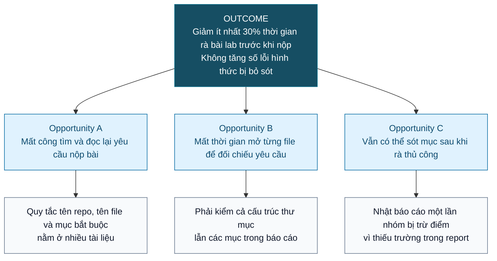
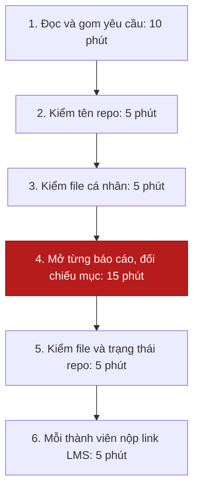
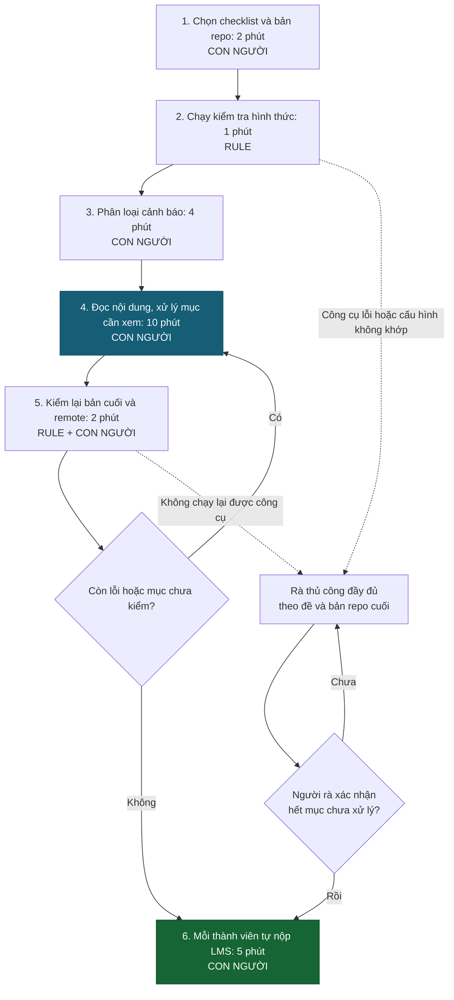

# Báo cáo nhóm — Day 02 Discovery & Problem Framing

> Bản chung của nhóm, viết trên repo do nhóm trưởng fork. Không copy file này sang repo cá nhân.
> Template chi tiết và prompt mẫu: [docs/01-worksheet.md](../../docs/01-worksheet.md). Bài mẫu: [docs/02-deliverable-example.md](../../docs/02-deliverable-example.md).

## 1. Thông tin nhóm

- Tên nhóm: E99
- Thành viên: xem `TEAM.md`
- Candidate problem được chọn (1 câu):
- Quyết định cuối: Go / Not Yet / No-Go

---

## 2. Hội tụ nhóm (CP3)

### 2.1. Pitch

Bảng tổng hợp 9 candidate của Pham Quang Tuan, Nguyen Trong Lam và Chu Văn Nhật. Candidate #1–#3 tham chiếu [Problem Cards của Pham Quang Tuan](../individual/2A202603824_PhamQuangTuan.md#3-top-3-problem-cards--quy-trình-nháp-cp2), bottleneck còn là giả thuyết cần kiểm chứng. Số liệu ở candidate #4–#9 được giữ theo nội dung thành viên cung cấp. Câu hỏi phản biện và người hỏi được đồng bộ từ cập nhật của nhóm trên main.

|   # | Người đưa ra                   | Candidate (Job Story ngắn)                                                                                                                                                                                                                        | Actor                                                        | Bottleneck                                                                                                                                                              | Câu hỏi phản biện nhận được (ai hỏi)                                                                                               |
| --: | ------------------------------ | ------------------------------------------------------------------------------------------------------------------------------------------------------------------------------------------------------------------------------------------------- | ------------------------------------------------------------ | ----------------------------------------------------------------------------------------------------------------------------------------------------------------------- | ---------------------------------------------------------------------------------------------------------------------------------- |
|   1 | Pham Quang Tuan — 2A202603824  | **Bỏ sót hoặc ghi trùng đơn qua tin nhắn:** Khi nhiều khách nhắn đặt món giờ trưa, tôi muốn biết hội thoại nào đã thành đơn được xác nhận, để không bỏ quên khách hoặc ghi trùng đơn.                                                             | Chủ quán hoặc nhân viên nhận đơn, đồng thời phục vụ tại quầy | Đọc và tổng hợp chuỗi tin khi liên tục bị gián đoạn; cần xác minh điểm sót ở đọc tin, ghi phiếu hay chuyển bếp                                                          | "Nếu quán dùng form đặt món cố định (No AI) thì khách có chịu dùng không?" (Nhật hỏi)                                              |
|   2 | Pham Quang Tuan — 2A202603824  | **Thay đổi đơn không tới người chuẩn bị:** Khi khách đổi món sau khi đã chuyển đơn, tôi muốn biết thay đổi thuộc đơn nào và bếp đã làm tới đâu, để xử lý đúng lúc và tránh dùng thông tin cũ.                                                     | Nhân viên nhận tin và người chuẩn bị đang dùng phiếu đã chốt | Xác định trạng thái chế biến và phiên bản phiếu bếp đang dùng trước khi chấp nhận thay đổi                                                                              | "Làm sao kết nối trạng thái của bếp theo thời gian thực nếu bếp không dùng màn hình KDS?" (Lâm hỏi)                                |
|   3 | Pham Quang Tuan — 2A202603824  | **Giao thiếu hoặc nhầm túi đồ:** Khi giao túi đồ cho khách hoặc người tới lấy, tôi muốn đối chiếu đúng đơn và đủ món, để không giao nhầm hoặc thiếu món.                                                                                          | Nhân viên đóng gói và bàn giao đơn mang đi                   | Đối chiếu món, số lượng và ghi chú với phiếu trước khi bàn giao                                                                                                         | "In bill dán lên túi đồ và tick kiểm thủ công (Rule) đã đủ giải quyết chưa?" (Nhật hỏi)                                            |
|   4 | Nguyen Trong Lam — 2A202603817 | **Tổng hợp phân công và quyết định từ chat nhóm:** Khi nhóm trao đổi hàng trăm tin nhắn mỗi tuần, tôi muốn biết ai đã nhận việc gì, việc nào chưa xong và quyết định nào đã chốt, để không phải nhắn hỏi từng người.                              | Nhóm trưởng; thành viên được giao việc chưa rõ ràng          | Lướt lại chat mất khoảng 20–30 phút/lần, nhắn hỏi từng người mất khoảng 10–15 phút/lần; lặp 5–10 lần/tuần                                                               | "Các thỏa thuận ngầm hoặc tiếng lóng trong chat Zalo có làm công cụ hiểu sai không?" (Nhật hỏi)                                    |
|   5 | Nguyen Trong Lam — 2A202603817 | **Đối chiếu yêu cầu tuyển dụng để xác định kỹ năng còn thiếu:** Khi chuẩn bị đi xin việc, tôi muốn so sánh nhanh yêu cầu của nhiều công ty và biết mình thiếu kỹ năng gì, để tập trung ôn đúng thứ.                                               | Sinh viên năm cuối trong giai đoạn xin việc                  | Đọc và đối chiếu khoảng 20–30 phút/JD, tổng 5–10 giờ/tuần (thành viên ghi đã đo); khó thấy kỹ năng nào xuất hiện nhiều nhất trên toàn bộ JD                             | "Mỗi công ty viết JD một kiểu và có yêu cầu ngầm, làm sao xếp hạng kỹ năng chuẩn xác được?" (Tuấn hỏi)                             |
|   6 | Nguyen Trong Lam — 2A202603817 | **Đồng bộ định dạng và nội dung liên quan trong báo cáo:** Khi giảng viên yêu cầu sửa định dạng hoặc nội dung báo cáo, tôi muốn cập nhật một chỗ mà các phần liên quan như mục lục, hình và trích dẫn cùng đồng bộ, để khỏi chỉnh tay từng trang. | Sinh viên làm báo cáo đồ án, khóa luận                       | Chỉnh định dạng và đồng bộ mục lục, hình, trích dẫn mất khoảng 2–5 giờ/vòng, 2–3 vòng/báo cáo (thành viên ghi đã đo)                                                    | "Dùng tính năng Styles, Caption và References tự động trong Word/LaTeX có đủ giải quyết bài này mà không cần AI không?" (Nhật hỏi) |
|   7 | Chu Văn Nhật — 2A202603848     | **Đối chiếu checklist bài nộp lab:** Khi chuẩn bị nộp bài lab môn AI trước hạn chót, tôi muốn đối chiếu nhanh toàn bộ cấu trúc repo và checklist yêu cầu, để không bị trừ điểm do sai sót hình thức như sai tên file hoặc thiếu mục.              | Sinh viên làm lab; bạn cùng nhóm                             | Mở từng file dò thủ công mất trung bình 35–45 phút; diễn ra 1 lần/tuần trước 23h50. Thành viên cho biết tuần trước nhóm bị trừ 5 điểm vì sót 1 trường trong file report | "Nếu chỉ cần kiểm tra tên file/folder thì một shell script (Rule) có đủ chưa, tại sao cần AI?" (Lâm hỏi)                           |
|   8 | Chu Văn Nhật — 2A202603848     | **Tìm lại giải đáp cũ trong chat lớp:** Khi gặp sự cố kỹ thuật hoặc thắc mắc về đề bài lab, tôi muốn tìm lại nhanh giải đáp mà giảng viên hoặc trợ giảng đã trả lời trong kênh chat lớp, để tự sửa ngay mà không phải hỏi lặp lại.                | Sinh viên trong lớp khoảng 40–50 bạn; trợ giảng              | Tìm từ khóa trong hàng nghìn tin nhắn mất 15–20 phút/lần, 2–3 lần/tuần; theo thành viên, trợ giảng trả lời cùng một câu hỏi cài đặt môi trường ít nhất 4 lần/tuần       | "Nếu không có quyền admin bot Discord/Teams thì làm sao trích xuất được dữ liệu chat tự động?" (Tuấn hỏi)                          |
|   9 | Chu Văn Nhật — 2A202603848     | **Nắm tiến độ và blocker trước deadline đồ án:** Khi sắp đến hạn nộp đồ án nhóm, tôi muốn biết chính xác ai đã làm xong phần nào và ai đang gặp vướng mắc, để chủ động hỗ trợ hoặc phân bổ lại công việc kịp deadline.                            | Trưởng nhóm; 3–4 thành viên                                  | Nhắn từng người và đọc lại chat mất 45–60 phút/lần, 2 lần/tuần; thành viên cho biết tuần trước có 1 task chậm 2 ngày do kẹt bug nhưng không thông báo sớm               | "Dùng bảng Kanban (Trello/Notion) chuẩn có giải quyết được không nếu thành viên lười cập nhật?" (Lâm hỏi)                          |

### 2.2. Cluster

9 candidate được gom thành 4 cluster theo khó khăn chung trong quy trình:

| Cluster                          | Các candidate                                            | Pattern chung                                                                   |
| -------------------------------- | -------------------------------------------------------- | ------------------------------------------------------------------------------- |
| A — Tiếp nhận và bàn giao đơn ăn | #1 Sót/trùng đơn; #2 Sót thay đổi; #3 Giao thiếu/nhầm    | Thông tin đơn bị thiếu hoặc không thống nhất giữa người nhận, bếp và người giao |
| B — Phân công và tiến độ nhóm    | #4 Tổng hợp việc/quyết định; #9 Theo dõi tiến độ/blocker | Phải đọc lại chat và hỏi từng người để biết trạng thái công việc                |
| C — Tìm và đối chiếu thông tin   | #5 So sánh JD; #8 Tìm giải đáp cũ                        | Thông tin đã có nhưng nằm rải rác, khó tìm đúng phần cần dùng                   |
| D — Kiểm tra đầu ra              | #6 Đồng bộ báo cáo; #7 Kiểm checklist bài nộp            | Phải rà nhiều phần để phát hiện mục thiếu, sai hoặc chưa nhất quán              |

#4 và #9 gần nhau nên shortlist dùng #9 làm đại diện, tập trung vào lúc rà tiến độ trước deadline. Với cluster A, chọn #1 để xét riêng bước tiếp nhận đơn, tránh ôm cả vận hành quán. #6 và #7 cùng cluster nhưng thời gian sửa báo cáo và thời gian kiểm bài nộp được xem riêng.

### 2.3. Opportunity Solution Tree rút gọn

Cây tập trung vào candidate #7, hướng được ưu tiên theo bảng điểm ở mục 2.4. Các pain dưới đây sẽ được kiểm chứng ở CP4.

Mức giảm 30% là mục tiêu đề xuất, chưa phải kết quả đo. Phạm vi đang xét là tên, cấu trúc và mục bắt buộc; chất lượng lập luận vẫn cần người đọc đánh giá.

**Các ý loại khỏi tầng opportunity:** “chatbot kiểm bài”, “script quét repo”, “dashboard checklist”. Đây là cách giải quyết; pain cần giữ là mất thời gian đối chiếu và bỏ sót yêu cầu.

### 2.4. Chấm điểm shortlist (1–5)

Shortlist gồm #1, #9 và #7: ba tác vụ có actor rõ, có thể khoanh phạm vi và đo thời gian/lỗi. #5 cần thêm cách đánh giá năng lực so với JD; #6 cần tách công sửa nội dung khỏi định dạng; #8 còn vướng khả năng lấy dữ liệu chat và xác định câu trả lời còn phù hợp.

Chấm 7 tiêu chí với trọng số bằng nhau, tối đa 35 điểm. Điểm 1 là chưa rõ/chưa có cơ sở; 3 là đã mô tả được nhưng còn cần xác minh; 5 là rõ và thuận lợi để kiểm trong lab. Riêng bằng chứng: tự báo cáo cụ thể được 3; muốn đạt 5 cần có mẫu/log và nguồn xác nhận bổ sung. Phương án No AI/Rule đủ dùng vẫn có thể đạt điểm cao.

| Candidate                                  | Actor rõ | Quy trình rõ | Pain có bằng chứng | Impact đo được | Vừa sức lab | So sánh được No AI/Rule/Workflow/Agent | Nhóm hiểu domain |   Tổng |
| ------------------------------------------ | -------: | -----------: | -----------------: | -------------: | ----------: | -------------------------------------: | ---------------: | -----: |
| #1 — Bỏ sót/trùng đơn qua tin nhắn         |        5 |            4 |                  1 |              4 |           3 |                                      5 |                2 | **24** |
| #9 — Nắm tiến độ và blocker trước deadline |        4 |            4 |                  3 |              4 |           4 |                                      5 |                5 | **29** |
| #7 — Đối chiếu checklist bài nộp lab       |        5 |            5 |                  3 |              5 |           5 |                                      5 |                5 | **33** |

**Lý do chấm:**

- **#1 — 24/35:** Tác vụ nhận đơn cụ thể, nhưng thời gian mới là giả định và chưa có chủ quán xác nhận. Cần tiếp cận quán để quan sát, nên điểm bằng chứng và hiểu domain thấp hơn hai hướng còn lại.
- **#9 — 29/35:** Nhóm quen việc làm đồ án và có tình huống chậm task do thành viên cung cấp. Tuy nhiên, việc biết blocker còn phụ thuộc người gặp khó có báo tin hay không; cần xác định nguồn cập nhật đáng tin cậy.
- **#7 — 33/35:** Có repo và yêu cầu để đối chiếu ngay, dễ đo thời gian rà và lỗi bỏ sót. Nhật cung cấp trải nghiệm cụ thể nhưng chưa kèm log hoặc phản hồi chấm, nên bằng chứng chỉ đạt 3/5.

**Hướng ưu tiên theo điểm:** **#7 — Đối chiếu checklist bài nộp lab**; nhóm cần xác nhận lựa chọn trước CP4.

**Vì sao ưu tiên:** Phạm vi rõ, dữ liệu đầu vào sẵn có và dễ tìm người cùng gặp tác vụ để hỏi. Nhóm có thể kiểm tra nhu cầu trước khi quyết định checklist, Rule hay AI hỗ trợ.

**Vì sao chưa chọn hai hướng còn lại:** #9 khó phát hiện vướng mắc chưa được thành viên thông báo; #1 chưa có dữ liệu thực tế và điều kiện quan sát quán. Giữ cả hai làm phương án dự phòng.

**Cần làm rõ ở CP4:** Với #7, 35–45 phút là cả lượt rà, còn 15–20 phút trong card cá nhân là riêng bước đối chiếu file. Cần đo lại cùng phạm vi, kiểm tra trường hợp bị trừ điểm và hỏi người ngoài nhóm xem cách rà hiện tại đã đủ tốt chưa.

**Xử lý bất đồng:** Chưa ghi nhận. Nếu nhóm chọn khác thứ tự điểm, bổ sung lý do và điều kiện thực tế dẫn đến lựa chọn đó.

---

## 3. Kiểm chứng + research giải pháp đã có (CP4)

Tập trung vào candidate #7 — kiểm checklist bài nộp lab. Research đã thực hiện từ tài liệu chính thức; phỏng vấn người ngoài nhóm chưa thực hiện. Các tự báo cáo ở CP3 là tín hiệu ban đầu để đặt câu hỏi, chưa thay thế kiểm chứng.

### 3.1. Assumption Map

Thang bằng chứng: 1 = chưa có; 2 = có tín hiệu gián tiếp; 3 = có tự báo cáo cụ thể hoặc tài liệu kỹ thuật phù hợp; 4–5 cần kiểm trực tiếp và đối chiếu thêm. Điểm dưới đây đánh giá đúng từng giả định, không suy từ tính năng công cụ sang nhu cầu người dùng.

|   # | Giả định                                                                                                       | Loại        | Quan trọng (1–5) | Đã có bằng chứng (1–5) | Kiểm chứng trước?                                            |
| --: | -------------------------------------------------------------------------------------------------------------- | ----------- | ---------------: | ---------------------: | ------------------------------------------------------------ |
|   1 | Sinh viên ngoài nhóm cũng mất công rà tên, cấu trúc và mục bắt buộc, không chỉ mất thời gian viết/sửa nội dung | Value       |                5 |                      2 | Có — quan sát một lần rà gần nhất                            |
|   2 | Checklist/template hiện có chưa đủ giảm thời gian và lỗi cho nhóm người dùng cần hỗ trợ                        | Value       |                5 |                      1 | Có — tìm cả người đã có cách làm tốt                         |
|   3 | Người dùng phân biệt được “đạt kiểm tra cấu trúc” với “nội dung đã đạt yêu cầu”                                | Usability   |                5 |                      1 | Có — cho xem mẫu kết quả, yêu cầu giải thích lại             |
|   4 | Có thể biến các yêu cầu hình thức thành quy tắc rõ và chỉ ra đúng file/mục cần xem                             | Feasibility |                5 |                      3 | Có — đối chiếu yêu cầu với repo mẫu; chưa coi là đã chạy thử |
|   5 | Lợi ích qua các lần nộp bù được công cấu hình và cập nhật khi đề thay đổi                                      | Viability   |                4 |                      1 | Đo công thiết lập, bảo trì và số lượt dùng lại               |
|   6 | Có thể kiểm bài bằng bản repo được phép truy cập, không cần quyền LMS hoặc gửi bài lên dịch vụ ngoài           | Feasibility |                4 |                      2 | Xác nhận quyền truy cập và thử phạm vi file cần đọc          |

**Ưu tiên:** #1 và #2 kiểm pain và cách đang xử lý; #3 kiểm nguy cơ người dùng tin nhầm; #4 kiểm khả năng làm một mẫu nhỏ. Chưa đề xuất AI trước khi biết các yêu cầu nào Rule đã xử lý đủ.

### 3.2. Kiểm chứng
#### Snapshot 1 — Sinh viên rà bài nhóm bằng tay

| Trường                                | Nội dung                                                                                                                 |
| ------------------------------------- | ------------------------------------------------------------------------------------------------------------------------ |
| Vai trò                               | Sinh viên phụ trách tổng hợp và rà repo nhóm trước khi nộp lab                                                           |
| Bối cảnh hỏi đáp                      | Kể lại tình huống chuẩn bị một lượt nộp bài và cách đối chiếu yêu cầu                                                    |
| Câu hỏi chính                         | “Trong lần nộp gần nhất, bạn kiểm bài theo những bước nào? Phần nào khiến bạn phải quay lại đọc nhiều nhất?”             |
| Câu trả lời                           | “Mình mở hướng dẫn rồi mở từng report. Mất công nhất là tìm mục nào đã điền, mục nào vẫn chỉ là khung.”                  |
| Diễn biến                             | Đọc lại yêu cầu, dò tên file, mở từng báo cáo, ghi các mục còn trống rồi nhắn tác giả bổ sung; sau đó kiểm lại bản cuối  |
| Cách đang xử lý                       | Checklist ghi tay và nhắn trong nhóm; chưa có cách chỉ thẳng tới mục cần xem                                             |
| Thời gian / tần suất trong tình huống | Khoảng 30 phút/lượt rà, một lượt trước mỗi lần nộp lab; không tính viết bài ban đầu                                      |
| Tín hiệu ủng hộ giả thuyết            | Công định vị và đối chiếu mục có thể là pain riêng, không chỉ là thời gian sửa bài                                       |
| Điều cần hỏi tiếp                     | Yêu cầu xem một checklist hoặc ví dụ mục từng bị sót; quan sát lại để tách thời gian tìm mục khỏi thời gian sửa nội dung |

#### Snapshot 2 — Sinh viên đã có checklist và template

| Trường                                | Nội dung                                                                                                                          |
| ------------------------------------- | --------------------------------------------------------------------------------------------------------------------------------- |
| Vai trò                               | Sinh viên chuẩn bị khung báo cáo ngay từ đầu và tự kiểm trước khi nộp                                                             |
| Bối cảnh hỏi đáp                      | Xem cách một người đã có quy trình ổn định rà bài lab                                                                             |
| Câu hỏi chính                         | “Trong lần nộp gần nhất, checklist giúp bạn làm được gì? Còn phần nào phải tự đọc kỹ?”                                            |
| Câu trả lời                           | “Mình mất khoảng 8 phút. Tên và thư mục có sẵn rồi; phần cần đọc kỹ là lập luận, không phải cấu trúc.”                            |
| Diễn biến                             | Dùng khung chuẩn, điền dần trong quá trình làm; trước khi nộp chỉ đối chiếu checklist và đọc các mục vừa thay đổi                 |
| Cách đang xử lý                       | Template đúng đề, checklist ngắn và phân công tác giả tự kiểm file của mình                                                       |
| Thời gian / tần suất trong tình huống | Khoảng 8 phút/lượt rà cuối; công tạo và cập nhật template chưa được tính                                                          |
| Tín hiệu phản bác                     | Không phải sinh viên nào cũng cần công cụ mới; với người đã có quy trình tốt, tự động kiểm cấu trúc có thể tiết kiệm ít thời gian |
| Điều cần hỏi tiếp                     | Đo thêm công chuẩn bị template, số lần dùng lại và lỗi vẫn lọt qua checklist; tránh chỉ so lượt rà cuối                           |

#### Snapshot 3 — Người review gặp mục đủ chữ nhưng thiếu ý

| Trường                                | Nội dung                                                                                                        |
| ------------------------------------- | --------------------------------------------------------------------------------------------------------------- |
| Vai trò                               | Sinh viên đọc và phản biện nội dung báo cáo của các thành viên                                                  |
| Bối cảnh hỏi đáp                      | Phân biệt đủ mục trong file với đáp ứng đúng yêu cầu của đề                                                     |
| Câu hỏi chính                         | “Có lỗi nào trong lần review gần nhất mà việc nhìn tên mục không phát hiện được? Bạn đã nhận ra bằng cách nào?” |
| Câu trả lời                           | “Mục metric có chữ nhưng chỉ ghi ‘nhanh hơn’, không có cách đo. Nếu chỉ kiểm heading thì vẫn thấy đủ.”          |
| Diễn biến                             | Mở mục metric, so với yêu cầu, nhận ra thiếu baseline và cách đo; hỏi tác giả làm rõ rồi đọc lại phần sửa       |
| Cách đang xử lý                       | Đọc nội dung theo checklist và trao đổi trực tiếp với tác giả                                                   |
| Thời gian / tần suất trong tình huống | Khoảng 15 phút cho bước review nội dung; chưa có tần suất để suy ra công theo tuần                              |
| Tín hiệu ủng hộ và giới hạn           | Cần thông báo rõ phần đã kiểm; công cụ kiểm cấu trúc không thay thế được người đánh giá lập luận                |
| Điều cần hỏi tiếp                     | Cho người dùng đọc mẫu kết quả “đủ heading, nội dung cần tự kiểm” và giải thích lại phần việc còn phải làm      |

#### Tổng hợp ba tình huống

| Tình huống          | Điều gợi mở                          | Tín hiệu phản bác / giới hạn                                   | Hướng cần kiểm ngoài thực tế                                |
| ------------------- | ------------------------------------ | -------------------------------------------------------------- | ----------------------------------------------------------- |
| 1 — Rà bằng tay     | Tìm và đối chiếu mục có thể tốn công | Chưa biết phần lớn thời gian nằm ở rà hay sửa                  | Quan sát thời gian từng bước và một lỗi cụ thể              |
| 2 — Có template     | Cách đơn giản có thể đã đủ           | Lợi ích công cụ mới có thể thấp; chưa tính công chuẩn bị       | So sánh tổng công qua nhiều lần nộp, không chỉ lượt rà cuối |
| 3 — Review nội dung | Đủ cấu trúc chưa bảo đảm đủ ý        | Không thể lấy trạng thái kiểm cấu trúc làm kết luận bài đã đạt | Thử cách diễn đạt kết quả và giữ bước con người duyệt       |

**Điều chỉnh đề xuất:** Thu hẹp actor ưu tiên vào người đang rà thủ công, chưa có checklist ổn định. Tách kiểm tên/file/mục khỏi đánh giá nội dung; metric phải tính cả công thiết lập và số lỗi bỏ sót. Người đã có template hiệu quả là nhóm đối chiếu để kiểm xem giải pháp mới có thực sự đáng dùng.

### 3.3. Research giải pháp đã có

Nguồn đã mở và kiểm ngày 09/11/2026. Bảng ghi khả năng theo tài liệu, chưa phải kết quả cài đặt hoặc thử nghiệm trong repo.

| Công cụ / case / pattern | Link                                                                            | Giải bước nào trong quy trình?                                           | Điểm mạnh                                                 | Khoảng trống / rủi ro                                                                                                               | Bài học cho nhóm                                                                      |
| ------------------------ | ------------------------------------------------------------------------------- | ------------------------------------------------------------------------ | --------------------------------------------------------- | ----------------------------------------------------------------------------------------------------------------------------------- | ------------------------------------------------------------------------------------- |
| markdownlint-cli2        | [Tài liệu chính thức](https://github.com/DavidAnson/markdownlint-cli2)          | Rà Markdown trên tập file theo cấu hình, thay một phần việc dò định dạng | Có cấu hình và bộ quy tắc, có thể tái sử dụng             | Không tự biết file/mục nào đề lab bắt buộc; không chấm đúng nội dung. Quy tắc phong cách mặc định có thể gây cảnh báo ngoài yêu cầu | Chỉ bật kiểm tra liên quan; kiểm đủ mục theo template cần cấu hình/logic riêng        |
| markdown-link-check      | [Tài liệu chính thức](https://github.com/tcort/markdown-link-check)             | Hỗ trợ rà liên kết trong báo cáo                                         | Tách được việc thử liên kết khỏi việc đọc toàn bộ báo cáo | Trang cần đăng nhập, giới hạn truy cập hoặc lỗi mạng cần người xác minh; link truy cập được không bảo đảm nguồn hỗ trợ claim        | Phân biệt lỗi chắc chắn với chưa kiểm được; người dùng vẫn mở và đọc nguồn quan trọng |
| GitHub checks            | [GitHub Docs](https://docs.github.com/en/pull-requests/reference/status-checks) | Gắn kết quả kiểm tra với commit để người rà xem đúng phiên bản           | Có trạng thái và thông tin chi tiết về kiểm tra           | Là cơ chế chạy/hiển thị kết quả, không phải bộ kiểm yêu cầu lab; cần thiết lập. Kết quả cũ không xác nhận bản mới hoặc việc nộp LMS | Có thể bắt đầu local; nếu đưa lên GitHub, chỉ dùng kết quả của đúng commit định nộp   |

**Kết luận research:** Không có cơ sở xây Agent chỉ để rà cấu trúc bài. Hướng cần thử là checklist theo đề + Rule kiểm phần rõ ràng + con người đọc phần cần hiểu nội dung. Còn phải kiểm chứng liệu lợi ích này đáng kể hơn cách sinh viên đang dùng và công cấu hình có hợp lý không.

---

## 4. Quy trình trước/sau (CP5)

Phạm vi phân tích là candidate #7 — đối chiếu checklist bài nộp lab. CP4 có các tình huống minh họa, chưa có phỏng vấn thực tế; quy trình và mục tiêu dưới đây là bản đề xuất để kiểm chứng.

### 4.1. Quy trình hiện tại

Actor chính là sinh viên phụ trách rà repo nhóm; tác giả từng báo cáo hỗ trợ làm rõ và tự sửa phần của mình. Đầu vào là bản bài làm hiện tại và bộ yêu cầu đang áp dụng; đầu ra là danh sách lỗi, bản đã rà và xác nhận nộp của từng thành viên.

Thời gian tham chiếu lấy từ [Problem Card của Nhật](../individual/2A202603848_ChuVanNhat.md#problem-card-1--kiểm-tra-checklist-bài-nộp-lab). **45 phút là tự báo cáo của một người, chưa phải baseline chung**. Theo phân rã trong card, 40 phút dành cho rà và 5 phút cho nộp LMS; cần đo lại để xác nhận.

| Bước | Actor | Input | Output / bàn giao | Thời gian tham chiếu |
|---:|---|---|---|---:|
| 1 | Người rà | Đề bài, hướng dẫn nộp, template | Danh sách yêu cầu cần đối chiếu | 10 phút |
| 2 | Người rà | Tên repo trên GitHub và quy tắc tên | Kết quả kiểm lớp, ngày, tên nhóm | 5 phút |
| 3 | Người rà | Danh sách thành viên, thư mục individual | Kết quả kiểm tên và sự hiện diện của file cá nhân | 5 phút |
| 4 | Người rà và tác giả | Báo cáo cá nhân/nhóm, danh sách yêu cầu | Các mục thiếu/trống hoặc cần tác giả làm rõ | 15 phút |
| 5 | Người rà và người đồng bộ repo | Trạng thái Git, file định nộp, bản remote | Bản cuối đã được đối chiếu với nội dung trên GitHub | 5 phút |
| 6 | Mỗi thành viên | Link repo và tài khoản LMS của mình | Xác nhận nộp của từng người | 5 phút |

**Bottleneck chính:** Bước 4 — mở từng file, tìm từng mục và đối chiếu. Card mô tả bước này khoảng 15–20 phút, sơ đồ dùng mốc 15 phút trong phân rã 45 phút. Việc đọc và gom lại yêu cầu ở bước 1 cũng tạo công lặp.

Tần suất: mỗi lượt chuẩn bị nộp lab. Các thời gian trên tính theo một người thực hiện tác vụ, không cộng 5 phút nộp của mọi thành viên thành thời gian rà của nhóm. Thời gian sửa nội dung lớn và chờ mạng ghi riêng, cùng cách ở hai phương án.

### 4.2. Quy trình tương lai

Hướng thử là **checklist đúng đề + Rule kiểm hình thức + con người duyệt nội dung**. Chưa dùng AI trong luồng chính. Công cụ chỉ cần báo đúng file/mục cần xem, không đánh giá thay người học.

| Bước | Actor / mức xử lý | Input | Output / bàn giao | Thời gian dự kiến |
|---:|---|---|---|---:|
| 1 | Người rà — con người | Checklist đã đối chiếu với đề; bản repo cần nộp | Phiên bản yêu cầu và dữ liệu đầu vào xác định | 2 phút |
| 2 | Bộ kiểm tra — Rule | Quy tắc tên/file/heading, danh sách thành viên, các file báo cáo | Danh sách lỗi và mục cần người kiểm, có vị trí cụ thể | 1 phút |
| 3 | Người rà — con người | Kết quả kiểm và yêu cầu gốc | Cảnh báo hợp lệ; mục không áp dụng có lý do; việc giao tác giả | 4 phút |
| 4 | Người rà và tác giả — con người | Nội dung báo cáo và danh sách mục cần xem | Người rà đối chiếu nội dung; tác giả tự sửa phần liên quan | 10 phút |
| 5 | Bộ kiểm tra và người rà | Bản cuối sau sửa, kết quả kiểm lại, bản remote | Kết quả được xác nhận cho đúng commit định nộp | 2 phút |
| 6 | Mỗi thành viên — con người | Link repo, bản đã rà, tài khoản LMS | Xác nhận nộp của chính thành viên | 5 phút |

Các mốc trên là kịch bản một vòng, chưa phải cam kết hiệu quả. Nếu phát hiện lỗi ở bước 5, quay lại xử lý rồi kiểm lại. Thời gian vòng lặp phải cộng vào kết quả thử thực tế.

**Rule kiểm được:** Mẫu tên, file bắt buộc, heading, ô trống/placeholder theo quy tắc và đường dẫn nội bộ. Có heading hoặc có chữ không bảo đảm nội dung đạt; phần cần hiểu nghĩa phải được gắn nhãn để người đọc xem.

Research ở [mục 3.3](#33-research-giải-pháp-đã-có) cho thấy đã có công cụ lint và kiểm link; kiểm đủ yêu cầu theo đề vẫn cần cấu hình riêng. Có thể thử local trước, chưa cần CI. Công cấu hình checklist ban đầu được đo riêng để đánh giá khả năng dùng lại.

**Boundary:** Công cụ chỉ đọc và báo vấn đề, không tự sửa/xóa file, viết bài, chấm điểm hay nộp LMS. Người dùng duyệt cảnh báo và nội dung; mọi sửa đổi sau lần kiểm phải được kiểm lại. Kết quả đạt kiểm tra hình thức không phải xác nhận bài đã đạt toàn bộ yêu cầu.

**Phương án quay về:** Công cụ lỗi hoặc cấu hình sai → rà bằng checklist thủ công từ yêu cầu gốc và đối chiếu bản remote; không bắt buộc chạy lại công cụ đang lỗi. Link cần đăng nhập/không truy cập được → người dùng mở và xác minh. Mục chưa kiểm phải giữ trạng thái chưa xác minh, không tự coi là đạt.

### 4.3. Before / after

| Chỉ số | Trước | Sau dự kiến | Cách hiểu |
|---|---|---|---|
| Số bước chính | 6 | 6 | Giảm công dò, giữ bước người duyệt và nộp |
| Thời gian rà, không gồm LMS | 40 phút theo phân rã card | 19 phút/vòng | 2 + 1 + 4 + 10 + 2; là chỉ số so với mục tiêu CP3 |
| Tổng thời gian rà và nộp | 45 phút theo card | 24 phút/vòng | Gồm thêm 5 phút nộp LMS của một người |
| Bước có con người tham gia | 6/6 | 5/6 | Bước 2 là Rule; bước 5 có người đối chiếu remote |
| Bottleneck | Đối chiếu từng mục: 15–20 phút | Đọc và duyệt nội dung: dự kiến 10 phút | Giữ bước kiểm soát chất lượng |
| Lỗi hình thức còn sót | Chưa có baseline kiểm độc lập | Không tăng trên cùng bộ yêu cầu | Không dùng số cảnh báo máy thay cho số lỗi thật |
| Rủi ro mới | Quên hoặc dò thiếu mục | Cấu hình thiếu, cảnh báo sai, dùng kết quả cũ | Người duyệt và kiểm đúng bản cuối |

Kịch bản 40 → 19 phút tương ứng giảm 52,5% thời gian rà; 45 → 24 phút tương ứng giảm khoảng 47% cả rà và nộp. Đây là phép tính từ giả định, chưa phải hiệu quả đã quan sát. Mục tiêu tối thiểu vẫn là giảm 30% phần rà theo CP3, không bắt buộc phải đạt đúng 19 phút.

**Cách đo:** Chọn ít nhất 3 sinh viên ngoài nhóm đang rà bài thủ công, ghi thời gian trên hai bộ bài có độ phức tạp tương đương; đổi thứ tự thử giữa người tham gia để giảm ảnh hưởng do quen tác vụ. Ghi số file, yêu cầu áp dụng, thời gian từng bước, vòng sửa, công thiết lập và thời gian chờ. Người rà độc lập kiểm lỗi còn sót theo cùng checklist; chỉ kết luận nhanh hơn khi số lỗi không tăng. Đây là kế hoạch thử, chưa có kết quả.

---

## 5. Problem Statement v0 (CP5)

Bản nháp cho nhóm phản biện và xác nhận. Baseline tham chiếu lấy từ card cá nhân, không lấy từ các snapshot minh họa ở CP4.

| Trường | Nội dung |
|---|---|
| **Actor** | Sinh viên phụ trách rà repo bài lab nhóm trước khi nộp, hiện phải mở và đối chiếu báo cáo thủ công |
| **Quy trình** | Đọc yêu cầu → kiểm tên repo/file → đối chiếu mục trong báo cáo → kiểm bản repo cuối → mỗi thành viên nộp link LMS |
| **Bottleneck** | Mở từng file, tìm từng mục để đối chiếu yêu cầu; khoảng 15–20 phút trong tự báo cáo của Nhật. Cần đo lại để biết công nằm ở tìm mục, hiểu yêu cầu hay sửa bài |
| **Impact** | Một tự báo cáo ghi 45 phút cho cả rà và nộp, trong đó khoảng 40 phút là phần rà. Có phản ánh thiếu trường trong report dẫn đến bị trừ điểm, chưa kèm phản hồi chấm để đối chiếu. Chưa suy rộng thời gian hoặc tỷ lệ lỗi cho cả lớp |
| **Success Metric** | **Baseline:** tạm tham chiếu 40 phút rà/lượt; xác nhận bằng bấm giờ trước thử. **Target:** giảm ít nhất 30% trung vị thời gian rà, tức ≤28 phút nếu baseline xác nhận là 40 phút, đồng thời không tăng lỗi hình thức bỏ sót. **Cách đo:** theo kế hoạch mục 4.3, cùng điểm bắt đầu/kết thúc và bộ yêu cầu áp dụng; kiểm cả thời gian sửa/kiểm lại trong phạm vi tác vụ. Ghi riêng 5 phút nộp LMS và công thiết lập để không làm sai phép so sánh |
| **Boundary** | Chỉ xét yêu cầu hình thức xác định được: tên, cấu trúc, mục bắt buộc và liên kết. Tác giả chịu trách nhiệm nội dung; người rà duyệt kết quả trước nộp. Bất kỳ công cụ/AI nào được cân nhắc sau này không tự viết bài, sửa/xóa file, chấm chất lượng lập luận hoặc nộp LMS |

**Phản biện của AI và điều chỉnh trong bản nháp:**

| Điểm còn yếu | Điều chỉnh | Phản hồi nhóm |
|---|---|---|
| 45 phút gồm nộp LMS, khác phạm vi “thời gian rà” ở CP3 | Tách phần rà tham chiếu 40 phút và phần nộp 5 phút; target chính tính trên thời gian rà | Chờ nhóm xác nhận |
| Có thể nhanh hơn nhưng bỏ sót lỗi hoặc báo đạt khi chưa đọc nội dung | Thêm điều kiện lỗi không tăng và người rà độc lập đối chiếu theo cùng yêu cầu | Chờ nhóm xác nhận |
| Thời gian có thể chủ yếu là sửa nội dung, không phải kiểm hình thức | Tách thời gian từng bước; đo lại và thu hẹp/đổi pain nếu giả định không đúng | Chờ nhóm xác nhận |

Cách viết v0 giữ vấn đề và tiêu chí thành công tách khỏi lựa chọn giải pháp, theo [Lean UX — Jeff Gothelf](https://jeffgothelf.com/blog/business-problem-statement-opportunity-statement/). Việc vẽ quy trình và đánh giá liệu AI có thêm giá trị được đối chiếu với [Google PAIR — User Needs + Defining Success](https://pair.withgoogle.com/chapter/user-needs/).

---

## 6. Mức can thiệp AI (CP6)

### 6.1. Ma trận độ mơ hồ × độ phức tạp

Bài của nhóm nằm ở ô:

Vì sao:

### 6.2. So sánh 4 mức

| Mức                       | Phương án cho bài của nhóm | Đủ khi nào | Rủi ro | Chọn? |
| ------------------------- | -------------------------- | ---------- | ------ | ----- |
| **No AI** (sửa quy trình) |                            |            |        |       |
| **Rule**                  |                            |            |        |       |
| **Workflow**              |                            |            |        |       |
| **Agent**                 |                            |            |        |       |

**Mức chọn:**

**Vì sao không chọn mức đơn giản hơn:**

### 6.3. AI Canvas rút gọn

| Thành phần                                                        | Nội dung |
| ----------------------------------------------------------------- | -------- |
| **Prediction** — AI dự đoán / tạo ra gì?                          |          |
| **Judgment** — con người cân nhắc, quyết định gì?                 |          |
| **Action** — hành động cuối cùng là gì, ai làm?                   |          |
| **Outcome** — đo kết quả bằng gì?                                 |          |
| **Input** — AI cần dữ liệu đầu vào gì mỗi lần chạy? Có sẵn không? |          |
| **Feedback** — lấy phản hồi ở đâu để cải thiện?                   |          |

### 6.4. Hai câu hỏi của Google PAIR

- Người dùng muốn **được hỗ trợ (augment)** hay **giao hẳn việc (automate)**? Bằng chứng:
- AI sai kiểu nào tệ hơn, **báo nhầm** hay **bỏ sót**? Vì sao, và thiết kế đã xử lý thế nào:

---

## 7. Problem Statement v1 + tiêu chí đánh giá (CP6)

| Trường                                          | Nội dung                        |
| ----------------------------------------------- | ------------------------------- |
| **Actor**                                       |                                 |
| **Quy trình**                                   |                                 |
| **Bottleneck**                                  |                                 |
| **Impact**                                      |                                 |
| **Success Metric** (baseline → target, cách đo) |                                 |
| **Boundary**                                    |                                 |
| **AI intervention point**                       |                                 |
| **Mức chọn**                                    | No AI / Rule / Workflow / Agent |
| **Rủi ro & người kiểm tra**                     |                                 |

**Thay đổi so với v0 và lý do:**

| Trường | v0  | v1  | Vì sao đổi |
| ------ | --- | --- | ---------- |
|        |     |     |            |

**Tiêu chí đánh giá đầu ra của AI (3–5 tiêu chí):**

|   # | Tiêu chí | Đạt khi | Không đạt khi |
| --: | -------- | ------- | ------------- |
|   1 |          |         |               |
|   2 |          |         |               |
|   3 |          |         |               |

---

## 8. Quyết định (CP6)

### 8.1. Bốn rủi ro

| Rủi ro          | Câu hỏi                                                           | Mức độ rủi ro (Thấp = an toàn / TB / Cao = nguy hiểm) | Lý do / bằng chứng |
| --------------- | ----------------------------------------------------------------- | ----------------------------------------------------- | ------------------ |
| **Value**       | Người dùng có thật sự cần và sẽ dùng không?                       |                                                       |                    |
| **Usability**   | Người dùng có dùng được, có hiểu và sửa được đầu ra của AI không? |                                                       |                    |
| **Feasibility** | Có đủ dữ liệu, công cụ, kỹ năng để làm không?                     |                                                       |                    |
| **Viability**   | Có hợp chi phí, pháp lý, quy định tổ chức không? Ai vận hành?     |                                                       |                    |

### 8.2. Kết luận

**Quyết định:** Go / Not Yet / No-Go

**Lý do:**

**Nếu Go — pilot nhỏ nhất:**

**Nếu Not Yet — cần kiểm chứng gì trước:**

**Nếu No-Go — nên làm gì thay AI:**

**Ngưỡng dừng** (nếu sau … mà … thì quay về …):

---

## 9. Hạn chế và hướng tiếp theo

-

## 10. Tài liệu tham khảo

-
